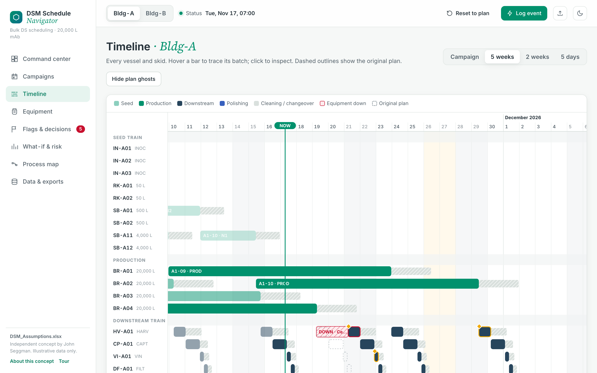
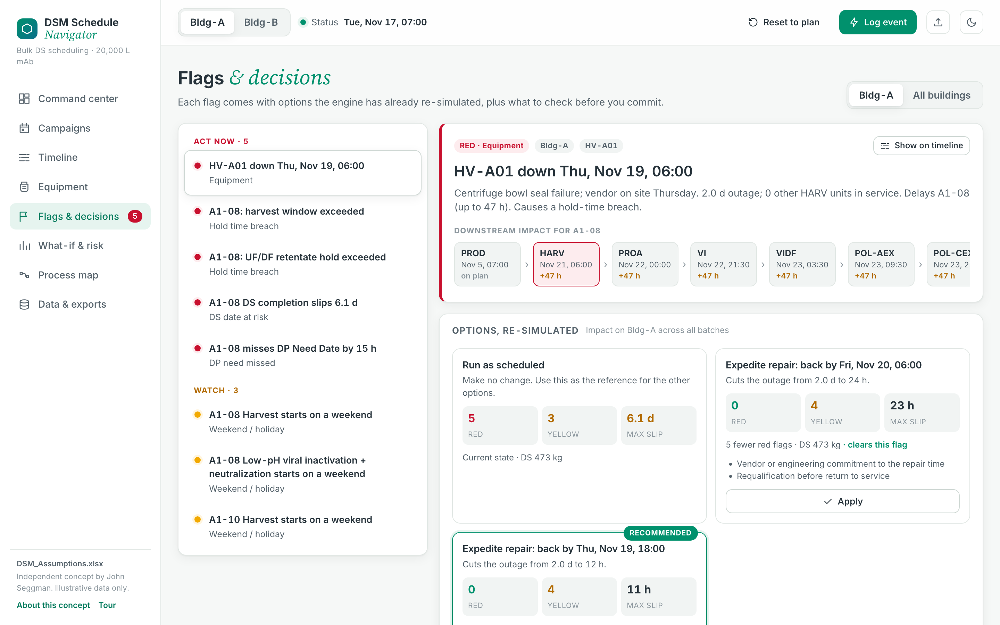

# DSM Schedule Navigator

**Scheduling and decision support for 20,000 L bulk drug substance manufacturing**

John Seggman · [jseggman@gmail.com](mailto:jseggman@gmail.com) · [linkedin.com/in/johnseggman](https://www.linkedin.com/in/johnseggman)

**[Open the live demo →](https://jseggs.github.io/dsm-navigator/)**

---

Bulk DS schedules are often kept in Excel and maintained by hand. This is a working tool that keeps Excel as the input but adds what a spreadsheet can't do well: when a window is missed, it shows where the delay lands downstream, which hold times are at risk, and which recovery options actually work.

| | |
|---|---|
|  |  |
| **Timeline:** a harvest-skid outage ripples through the downstream train. Dashed outlines show the original plan. | **Decision card:** each option is re-simulated across every batch before the AD commits. |

## Try it

| | |
|---|---|
| Live app | https://jseggs.github.io/dsm-navigator/ |
| Demo scenario ("a bad Tuesday") | https://jseggs.github.io/dsm-navigator/?view=timeline&demo=1 |
| Plan a campaign | https://jseggs.github.io/dsm-navigator/?view=campaigns&building=Bldg-B |
| Assumptions workbook | [DSM_Assumptions.xlsx](DSM_Assumptions.xlsx) |
| One-page overview | [DSM_Navigator_Overview.pdf](DSM_Navigator_Overview.pdf) |
| Quick start | [DSM_Navigator_Quick_Start.pdf](DSM_Navigator_Quick_Start.pdf) |

The app runs entirely in the browser. To run it offline, download [index.html](index.html) and open it; the default workbook is built in.

## How it works

- **Excel is the backend.** 13 input sheets: settings, batch list, process template, polishing options, equipment, mass balance, campaigns, hold limits, flag rules, crew, materials, calendar, and a live event log. Every default carries a source / confidence note.
- **Finite-capacity scheduler.** Seed train, 4 × 20 kL bioreactors and one shared downstream train per building, with cleaning turnaround, transfer windows, hold limits, and weekday-only steps.
- **Durations from process data.** Protein A time is computed from titer, column size and DBC (5 cycles at 4 g/L, 7 at 5.5 g/L), so a titer change re-plans capture automatically.
- **Campaign planning to the DP Need Date.** Enter lots and the date Drug Product needs released DS; the tool back-schedules into open capacity and hands the batch list back to Excel.
- **Event logging and equipment board.** Delay, equipment down, batch lost, or hold extension; mark any unit down or out of service and the train re-plans around it. Steps already running are locked.
- **Red and yellow flags** for hold breaches, DS slips, DP Need Dates at risk, station load, weekend starts, crew shortfalls, materials and resin life.
- **Monte Carlo** on min / likely / max durations for P50 / P90 DS dates and breach probability.
- **Runs offline** as one HTML file. No install, no server, no data leaves the laptop.

## What it surfaced with illustrative data

> **Harvest collision.** A 48 h centrifuge outage pushes the next Bldg-A harvest past its 36 h window. The tool computes the latest repair time that avoids the breach (Fri 13:00), which cuts red flags from 5 to 0.

> **Holiday cascade.** The same delay moves UF/DF onto Thanksgiving. With a weekday-only fill, the retentate waits 4.1 days against a 72 h hold, a second breach that is easy to miss by hand.

> **Cadence choice.** Running Bldg-B at 4.5 instead of 4.25 days between thaws drops the simulated chance of any hold breach from 13% to about 0% and costs about 6 h at campaign end.

> **Resin life.** Bldg-B Protein A resin runs out at batch B1-08. The tool finds the largest open window on the capture skid and schedules the re-pack there with no DS slip.

---

Independent concept by John Seggman. Built on public, industry-typical assumptions. Contains no proprietary data.
